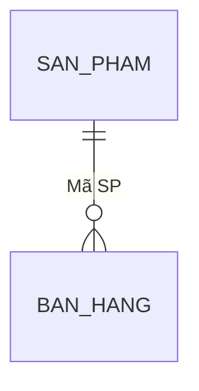

# Data (ETL) — {Tên dự án}

## 1. Tổng quan dữ liệu
- File nguồn: … · Số bảng/sheet dùng: … · Tổng số dòng sau làm sạch: …
- Các bảng: Tên → file `clean/…csv` (dòng trước → sau)

## 2. Transformation — kiểm tra 9 quy tắc theo từng bảng
### Bảng "{tên}"
| Quy tắc | Trạng thái | Chi tiết |
|---|---|---|
| R1 Mỗi cột có tiêu đề riêng | ✅ / 🛠 / ⚠ | … |
| R2 Không trống hoàn toàn (tiêu đề/hàng/cột) | | |
| R3 Tiêu đề không chứa công thức | | |
| R4 Không ô gộp | | |
| R5 Mỗi cột một loại thông tin | | |
| R6 Một định dạng thống nhất (Tabular Form) | | |
| R7 Trống thay vì giá trị thay thế | | |
| R8 Không dòng tổng cộng / tổng phụ | | |
| R9 Không dùng định dạng để phân loại | | |

**Các bước biến đổi đã thực hiện (theo thứ tự):** 1) … 2) … 3) …

## 3. Rà soát cột phục vụ Key Metrics
| Cột chặng 2 dùng | Bảng | Kiểu trong dữ liệu | Trống | Đánh giá |
|---|---|---|---|---|

## 4. Modeling
- **Vai trò bảng:** fact = …; dimension = …

| Quan hệ (FK → PK) | Cardinality | PK duy nhất? | FK khớp PK (%) | Orphan (giá trị/dòng) | Kết luận |
|---|---|---|---|---|---|

### Các vòng quay lại Transformation
| Vòng | Vấn đề phát hiện | Hành động | Kết quả |
|---|---|---|---|
| 1 | … | … | … |

## 5. Vấn đề còn tồn đọng và đề xuất
- (hoặc: "Không còn vấn đề.")

## 6. Kết luận
- Dữ liệu **sẵn sàng / chưa sẵn sàng** cho tính toán DAX. Lý do: …
- Cột ngày dùng cho time intelligence: …
